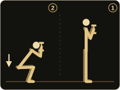

# بروتوكول التحول: نسخة البيت — قالب التصميم

مسودة تصميم أولى لكتاب «نسخة البيت» للرجال (قرار المالك d29). هذا قالب شكل فقط. أسماء التمارين والأرقام في `template.html` أمثلة توضّح التصميم، وليست المحتوى النهائي. المحتوى وروابط المقاطع يجهزها ياسر، والتدقيق اللغوي على هيفاء بعد المسودة الأولى.

## الملفات

- `template.html`: معاينة من ثلاث صفحات: الغلاف، وصفحة «اختر برنامجك» (3 و4 و5 أيام)، ونموذج صفحة يوم تمرين فيها أربع بطاقات تمرين.
- `home.css`: الإضافات الخاصة بنسخة البيت فقط. الهوية نفسها (الألوان والخط وإطار الصفحة والرأس والتذييل) تُحمَّل كما هي من `../book/book.css`، فأي تعديل على هوية الكتاب الأول ينعكس هنا تلقائيًا.

## ما أُخذ من الكتاب الأول بدون تعديل

- الغلاف الأصلي `../book/identity/cover-01.svg` وشعار `../book/identity/source-07-00.png`. ما تعدّلت ملفات الهوية الأصلية ولا بصماتها. الغلاف الجديد هو الغلاف الأصلي وفوقه شارة «نسخة البيت» بـ HTML.
- خطوط Noto Sans Arabic المحلية من `../book/fonts/`، فما يُحمّل أي خط من الإنترنت.
- رأس الصفحة والتذييل والإطار الذهبي وأسلوب البطاقات والتنبيه (`callout`).

## بطاقة التمرين بنسختين

كل تمرين عنصر `article.ex`، وفيه نسختان جنب بعض:

| الجزء | النسخة الأولى | النسخة الثانية |
| --- | --- | --- |
| الفئة | `.version.dumbbell` بشارة ذهبية ممتلئة «بالدمبل» | `.version.no-dumbbell` بإطار متقطع وشارة مفرغة «بدون دمبل» |
| الاسم | `h3` بالعربي، والاسم الإنجليزي في `span.en` | مثلها |
| الصورة | `.figure-slot` (حط `` داخلها لما تجهز الصورة) | مثلها |
| الجرعة | `.dose-row`: المجموعات × التكرار، والراحة | مثلها |
| المقطع | `.video-link`: رمز QR في `.qr-slot` ورابط «شاهد الشرح ↗» | مثلها |

الفرق بين النسختين ما يعتمد على اللون وحده: فيه أيقونة وكلمة مكتوبة وشكل إطار مختلف، عشان يبان حتى في الطباعة بالأبيض والأسود.

### الحقول اللي يعبيها جدول المحتوى لكل نسخة

- اسم التمرين بالعربي والإنجليزي.
- العضلات المستهدفة (تكتب في رأس البطاقة).
- المجموعات والتكرار والراحة.
- رابط يوتيوب. شروط المقطع حسب القرار d28: يوضّح الأداء الصحيح، بدون موسيقى، وبدون بنت أو امرأة في المقطع.
- صورة التمرين (اختيارية في المسودة الأولى).

## صور التمارين (`figures/`)

22 رسمة SVG أصلية، وحدة لكل نسخة تمرين، باسم `<معرّف التمرين>-<with|without>.svg` (مثل `e1-with.svg` و`e1-without.svg`). المعرّفات نفسها اللي في `videos.json` (من `e1` إلى `e11`).

- الأسلوب نفسه حق مخطط الجسم في الكتاب الأول: جسم داكن بحجم، والعضلات اللي يشتغل عليها التمرين بالذهبي، والدمبل بلون عاجي عشان ما يختلط بالعضلات.
- كل الرسومات انرسمت من الصفر بالسكربت `figures/make_figures.py`. ما فيها أي لقطة أو صورة مصغرة من يوتيوب، ولا أي صورة حقوقها لغيرنا.
- في كل صورة رجل بسيط بوضعين: (1) وضع البداية و(2) وضع النهاية، مع أسهم توضّح اتجاه الحركة. في نسخة الدمبل يظهر الدمبل، وفي نسخة بدون دمبل ما يظهر.
- التمارين اللي تنعمل وقوف يكون فيها الوضعان جنب بعض: (1) يمين و(2) يسار، لأن القراءة بالعربي من اليمين. التمارين اللي تنعمل على الأرض يكون فيها (1) فوق و(2) تحت، عشان تطلع الرسمة أكبر.
- الألوان ذهبية على الخلفية الداكنة نفسها، والصورة كاملة (خطوط متجهة) فتنطبع واضحة بأي حجم.
- تعديل أي وضعية: غيّر زوايا الجسم في `FIGS` داخل السكربت، وبعدها شغّل:

```sh
python3 docs/book-home/figures/make_figures.py
```

### ربطها بالكتاب (شغل ياسر)

الصورة نفسها هي الرابط للمقطع، مثل الكتاب الأول:

```html
<a class="figure-slot" href="رابط يوتيوب" aria-label="شاهد شرح …"></a>
```

لما تكون الصورة من `figures/`، يوسّع `home.css` عمود الصورة من 24 إلى 34 ملم، ويشيل الخلفية البيضاء حق رمز QR. جرّبت هالشي على المسودة كاملة (19 صفحة) بعد ما حطيت الصور مكان رموز QR: كل صفحة A4 باقي فيها 47px أو أكثر فوق التذييل. نسخة الكتاب الحالية اللي فيها رموز QR ما تتغير لين تنربط الصور.

## صفحة افتتاح البرنامج وصفحة اليوم (`pages.py`)

نفس فكرة صفحتي «5 أيام تمرين» و«يوم الدفع» في الكتاب الأول:

- `divider_page(عدد الأيام، الأيام، معرّف الصفحة)`: رقم ذهبي كبير، و«أيام تمرين»، ومربع لكل يوم فيه اسمه بالعربي والإنجليزي، والجرعة تحت.
- `day_page(...)`: عنوان اليوم بالإنجليزي والعربي، ومخطط جسم أمامي وخلفي فيه عضلات اليوم بالذهبي، وأسماء العضلات بالعربي، وقائمة تمارين اليوم.
- مخطط الجسم رسم أصلي من أشكال بسيطة. كل عضلة شكل له اسم (`m-chest`، `m-back`، …)، و`home.css` يلوّن العضلات المكتوبة في `data-on`. يعني نفس الرسمة تنفع لكل الأيام، وعضلات اليوم تنحسب من تمارينه بالقاموس `EXERCISE_MUSCLES`.
- المعاينة: `divider.html` (البرامج الثلاثة) و`day.html` (ثلاثة أيام كمثال). تتولّد بالأمر `python3 docs/book-home/pages.py`. المحتوى في المعاينة مأخوذ من `plan.md`، والبناء النهائي في `build.py` يستدعي الدالتين.


- صفحة A4 تشيل أربع بطاقات تمرين، والمسافة الباقية فوق التذييل 34px تقريبًا. اليوم اللي فيه أكثر من أربعة تمارين ينقسم على صفحتين.
- على الجوال (عرض 390px) تنزل النسختان تحت بعض، وما فيه تمرير جانبي. الدائرة الزخرفية المشتركة في `book.css` كانت تسبب تمريرًا جانبيًا على الجوال، وانقصّت هنا فقط عن طريق `home.css`.

## المعاينة

من جذر المستودع:

```sh
cd docs && python3 -m http.server 8000
# ثم افتح http://127.0.0.1:8000/book-home/template.html
```

## الخطوات الجاية

1. ياسر يسلّم جدول المحتوى للمالك.
2. بعد الموافقة يُبنى الكتاب كامل من القالب بسكربت بناء، بنفس طريقة `scripts/build-book.py`، ويطلع منه ملف PDF.
3. هيفاء تراجع اللغة بعد المسودة الأولى.

ممنوع في هالكتاب: أي وعد صحي، أو وعد بنزول وزن، أو صور قبل وبعد.

## المحتوى والبناء (المسودة الأولى، ياسر)

بعد موافقة المالك على جدول المحتوى (القرار d29)، انبنى الكتاب كامل من القالب:

- `index.html`: الكتاب (19 صفحة): الغلاف، اختر برنامجك، كيف تستخدم الكتاب، برامج 3 و4 و5 أيام (صفحة أو صفحتين لكل يوم)، فهرس التمارين والمقاطع، وسجل المتابعة. يتولّد من `build.py`، فلا تعدّله باليد.
- `plan.md`: جدول المحتوى للمالك (التمارين ونسختاها والجرعات والبرامج وتفاصيل فحص المقاطع).
- `videos.json`: المقاطع المفحوصة (22 مقطع). منه يقرأ السكربت الروابط. لو بدّلت مقطعًا، عدّل هذا الملف ثم أعد البناء.
- `figures/`: صور التمارين (SVG أصلية من سارة) باسم `<معرّف التمرين>-<with|without>.svg`. الصورة نفسها رابط المقطع في الكتاب.
- `content.css`: تنسيق صفحات المحتوى فوق `home.css` (صورة التمرين كرابط، وتلميح الأداء، والجدول الداكن للفهرس). ما غيّرت `home.css` ولا هوية الكتاب الأول.

لإعادة البناء من جذر المستودع (بدون أي مكتبات خارجية):

```sh
python3 docs/book-home/build.py
```

ملف PDF للمراجعة في `protocoltraining-home-draft.pdf` (جنب هذا الملف)، يُصدَّر بـ Chromium: افتح `docs/` بخادم محلي واطبع `book-home/index.html` بحجم A4 مع الخلفيات.

- `check_durations.py`: يطبع مدة كل مقطع ويعلّم الطويل (فوق 45 ثانية). شغّله على جهازك (يحتاج yt-dlp)، لأن يوتيوب يمنع قراءة المدة من السيرفر: `python3 docs/book-home/check_durations.py`.

ملاحظات:

- في بطاقة كل نسخة: صورة التمرين هي الرابط للمقطع، ولو الصورة ما وصلت بعد يظهر مكانها «صورة التمرين».
- المقاطع من يوتيوب ومالكوها غير مدار، وفُحصت بالعنوان وثلاثة إطارات فقط. الموسيقى والصوت والمدة غير مفحوصة.
